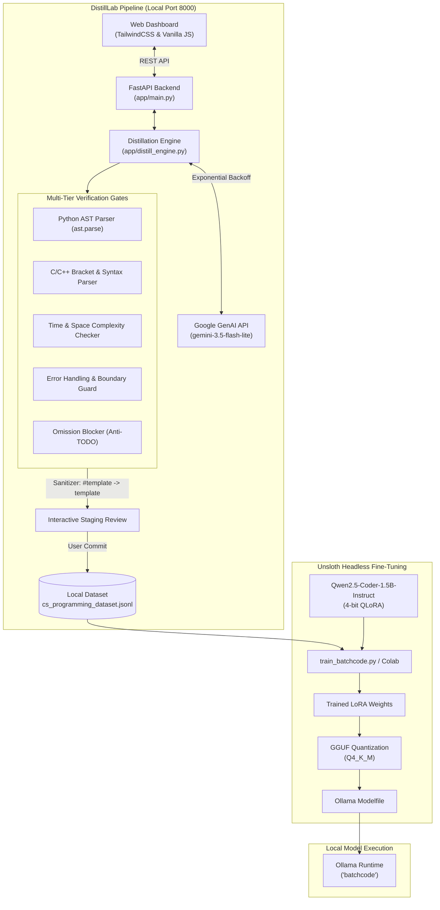

# DistillLab & BatchCode

> **An end-to-end dataset distillation dashboard and quantized fine-tuning pipeline for local LLMs, powered by the Google Gemini API, FastAPI, and Unsloth.**

[](https://www.python.org/downloads/)
[](https://fastapi.tiangolo.com)
[](https://github.com/googleapis/python-genai)
[](https://github.com/unslothai/unsloth)
[](https://huggingface.co/Qwen/Qwen2.5-Coder-1.5B-Instruct)
[](LICENSE)

---

## Table of Contents
- [1. Executive Summary](#1-executive-summary)
- [2. System Architecture](#2-system-architecture)
- [3. Core Features](#3-core-features)
- [4. Verification Pipeline](#4-verification-pipeline)
- [5. Dataset Schema & Sanitization](#5-dataset-schema--sanitization)
- [6. Retraining & Quantization: 'batchcode'](#6-retraining--quantization-batchcode)
- [7. Quickstart Guide](#7-quickstart-guide)
- [8. API Reference](#8-api-reference)
- [9. Ollama Local Deployment](#9-ollama-local-deployment)
- [10. Repository Structure](#10-repository-structure)
- [11. License](#11-license)

---

## 1. Executive Summary

**DistillLab** solves the data-scarcity and validation dilemma when fine-tuning compact local coding models. Small models (such as `Qwen2.5-Coder-1.5B`) are exceptionally sensitive to noisy training data, broken code syntax, omitted implementations (`// TODO`), and invalid preprocessor directives.

DistillLab pairs Google's Gemini models (`gemini-3.5-flash-lite` / `gemini-3.8-flash`) with a rigorous, multi-gate validation engine and a local FastAPI dashboard to distill, review, sanitize, and export high-density `.jsonl` datasets.

The distilled dataset directly feeds **BatchCode**—a fine-tuned, quantized 4-bit LoRA model exported to GGUF format for instant zero-dependency execution in Ollama.

---

## 2. System Architecture



---

## 3. Core Features

- **Production-Grade Teacher Model**: Harnesses Gemini 3.5 Flash Lite / 3.8 Flash with structured JSON schema outputs (`response_mime_type="application/json"`, Pydantic `SFTBatch`).
- **Resilient Transport**: Async execution with jittered exponential backoff handles transient `429` (Rate Limit) and `503` (Unavailable) conditions gracefully.
- **5 Built-in Senior CS Presets**:
  1. *Systems Programming (C/C++)*: Manual memory management, pointers, custom allocators, RAII.
  2. *Concurrency & Threading*: Lock-free queues, atomic memory orders (`acquire`/`release`), condition variables.
  3. *Algorithmic Graph Theory*: Tarjan's SCC, Dinic's Max Flow, Shortest Paths, Topological Sort.
  4. *OS Internals & Kernels*: Virtual memory paging, epoll event loops, shared memory IPC.
  5. *Database Storage Engines*: B+ Trees, LSM-Trees, Write-Ahead Logging (WAL), Buffer Pools.
- **Interactive Staging & Review**: Generated samples enter a live inspection table before committing to disk. Inspect syntax check notes, token metrics, reject faulty samples, or auto-commit batches.
- **Token Length Estimator**: Real-time approximation ($\approx \text{chars} / 3.8$) flags context overflows (> 4,096 tokens) to prevent clipping during fine-tuning.

---

## 4. Verification Pipeline

Every distilled candidate must satisfy all five gates before staging:

1. **Python Syntax Verification**:
   Extracts code within ```python fences and runs `ast.parse()`. Fails on any syntax error with line and column reporting.
2. **C/C++ Structural Integrity**:
   Extracts C/C++ blocks, strips comments and literal strings, verifies balance of parentheses `()`, brackets `[]`, braces `{}`, and ensures valid statement structure with terminating semicolons.
3. **Computational Complexity Guard**:
   Enforces explicit time and space complexity analysis with Big-O notation ($O(N)$, $O(\log N)$, etc.).
4. **Defensive Error Handling**:
   Ensures implementations include boundary guards, null pointer checks, assertions, try/catch blocks, or result types.
5. **Anti-Omission Filter**:
   Rejects lazy completions containing placeholders such as `// TODO`, `// implement here`, or `/* left as exercise */`.

---

## 5. Dataset Schema & Sanitization

### Output Schema (ShareGPT / OpenAI ChatML Format)

DistillLab records samples directly into `data/cs_programming_dataset.jsonl`:

```json
{
  "messages": [
    {
      "role": "system",
      "content": "You are a Staff Software Engineer..."
    },
    {
      "role": "user",
      "content": "Implement a lock-free single-producer single-consumer (SPSC) ring buffer in C++20..."
    },
    {
      "role": "assistant",
      "content": "Here is the production-grade implementation using std::atomic with memory_order_acquire/release...\n\n```cpp\n#include <atomic>\n#include <vector>\n..."
    }
  ]
}
```

### Preprocessor Sanitizer
When LLMs generate markdown headers without spaces (e.g. `#template <typename T>` or `#requires (...)`), compilers treat them as invalid C++ preprocessor directives. DistillLab includes an automatic sanitizer:
- `#template` $\rightarrow$ `template`
- `#requires` $\rightarrow$ `requires`
- `#concept` $\rightarrow$ `concept`

Sanitization runs automatically inside `commit_to_jsonl()`, inside `train_batchcode.py`, and can be triggered via `POST /api/dataset/sanitize`.

---

## 6. Retraining & Quantization: 'batchcode'

The dataset is trained into a dedicated coding model named **`batchcode`**:

- **Base Model**: `Qwen/Qwen2.5-Coder-1.5B-Instruct`
- **Fine-Tuning Framework**: [Unsloth](https://github.com/unslothai/unsloth) 4-bit QLoRA
- **LoRA Configuration**: $r=16$, $\alpha=16$, targeting `q_proj`, `k_proj`, `v_proj`, `o_proj`, `gate_proj`, `up_proj`, `down_proj`.
- **Max Sequence Length**: 2048 tokens
- **Output Format**: Quantized GGUF (`q4_k_m`) with auto-generated Ollama `Modelfile`.

### Execution Options
1. **Headless Linux / RunPod / Cloud VM**:
   ```bash
   bash run_headless.sh
   ```
2. **Google Colab (Free T4 GPU)**:
   Open [`train_batchcode_colab.ipynb`](train_batchcode_colab.ipynb) in Colab and run all cells.

---

## 7. Quickstart Guide

### 1. Prerequisites
- Python 3.11+
- A Google Gemini API Key ([Google AI Studio](https://aistudio.google.com/))
- [Ollama](https://ollama.com/) (for local model serving)

### 2. Installation
```bash
git clone https://github.com/batch15studios/DistillLab.git
cd DistillLab

# Create virtual environment
python -m venv .venv
source .venv/bin/activate  # Windows: .venv\Scripts\activate

# Install dependencies
pip install -r requirements.txt
```

### 3. Configure API Key
Create a `.env` file or enter it through the UI modal:
```env
GEMINI_API_KEY=your_gemini_api_key_here
```

### 4. Start DistillLab Dashboard
```bash
uvicorn app.main:app --port 8000 --reload
```
Open **`http://localhost:8000`** in your browser.

---

## 8. API Reference

| Method | Endpoint | Description |
| :--- | :--- | :--- |
| `POST` | `/api/generate` | Generates a batch with live validation and token estimation. |
| `GET` | `/api/samples` | Lists paginated committed samples with full-text search. |
| `POST` | `/api/samples/commit` | Appends reviewed samples to the `.jsonl` dataset. |
| `DELETE`| `/api/samples/{index}` | Deletes a specific line/sample from the dataset. |
| `POST` | `/api/dataset/sanitize` | Scans and cleans `#template` / `#requires` anomalies. |
| `GET` | `/api/export` | Downloads the compiled `.jsonl` dataset file. |
| `GET` | `/api/stats` | Returns total samples, file size, token totals, and averages. |
| `GET` | `/api/presets` | Retrieves available CS topic domain presets. |

---

## 9. Ollama Local Deployment

Once trained or imported, execute **`batchcode`** locally:

```bash
# Verify registered models
ollama list

# Run batchcode interactively
ollama run batchcode

# REST API generation
curl http://localhost:11434/api/generate -d '{
  "model": "batchcode",
  "prompt": "Write a 3-line C function to check if an integer is a power of two using bitwise operators.",
  "stream": false
}'
```

---

## 10. Repository Structure

```
DistillLab/
├── app/
│   ├── distill_engine.py       # Core distillation, AST/C++ validation, and Gemini client
│   ├── main.py                 # FastAPI backend endpoints & static router
│   └── templates/
│       └── index.html          # Modern Tailwind CSS interactive UI dashboard
├── data/
│   └── cs_programming_dataset.jsonl  # ShareGPT/ChatML formatted distilled dataset
├── Modelfile_batchcode         # Ollama Modelfile configuration
├── requirements.txt            # Python dependencies
├── run_headless.sh             # 1-command headless Unsloth training script
├── train_batchcode.py          # Standalone Unsloth training & GGUF quantization script
├── train_batchcode_colab.ipynb # Interactive Google Colab notebook
├── .gitignore                  # Git ignore rules for virtual environments & weights
└── README.md                   # Complete architectural and setup guide
```

---

## 11. License

Released under the [MIT License](LICENSE). Contributions, forks, and pull requests are welcome!
